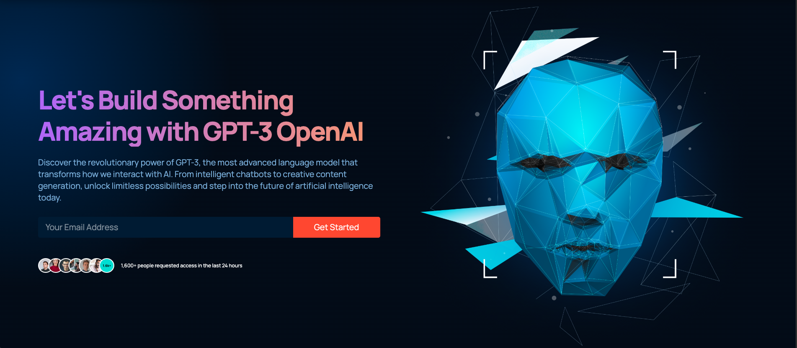
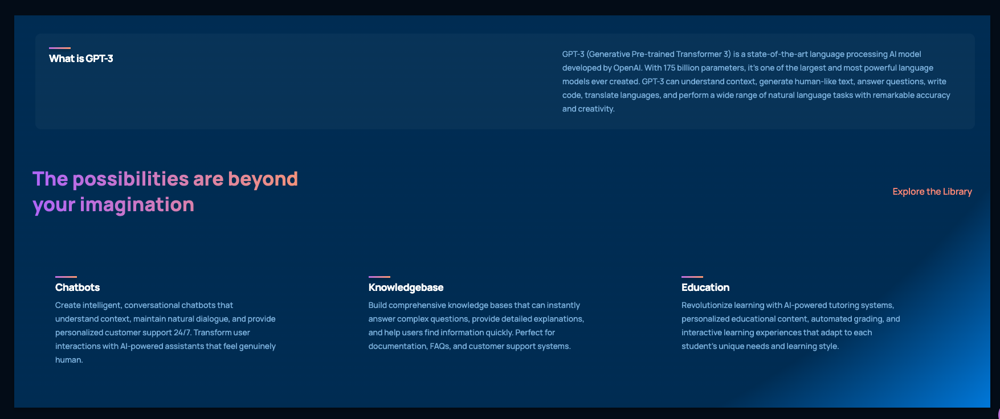
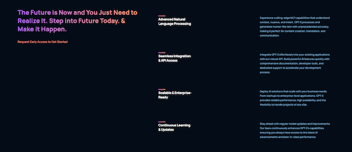
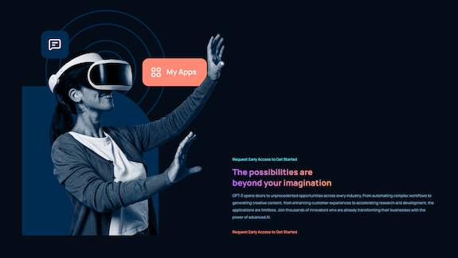
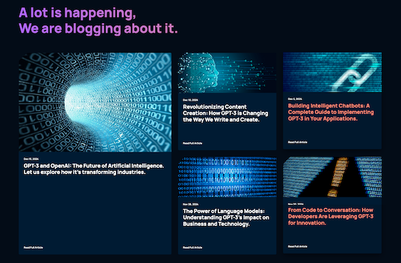
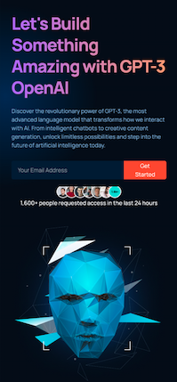
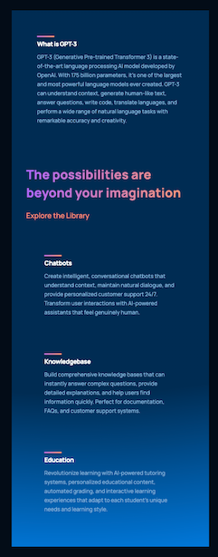
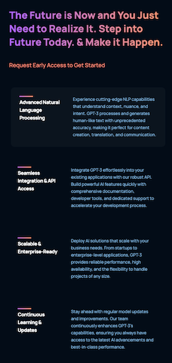

# 🚀 GPT-3 OpenAI Website

> A modern, production-ready React website showcasing the power of GPT-3 and OpenAI technology. Built with cutting-edge design principles and optimized for performance.

[](https://devreactgpt3.netlify.app/)
[](https://reactjs.org/)
[](LICENSE)

## 📋 Table of Contents

- [Overview](#-overview)
- [Features](#-features)
- [Screenshots](#-screenshots)
- [Tech Stack](#-tech-stack)
- [Live Demo](#-live-demo)
- [Installation](#-installation)
- [Project Structure](#-project-structure)
- [Key Highlights](#-key-highlights)
- [Performance](#-performance)
- [Contact](#-contact)

## 🎯 Overview

This is a fully responsive, production-ready website built with React that demonstrates modern web development practices. The project showcases GPT-3 and OpenAI technology through an elegant, user-friendly interface with smooth animations, interactive elements, and optimized performance.

**Perfect for showcasing:**

- Modern React development skills
- Responsive design expertise
- UI/UX design capabilities
- Production-ready code quality
- Performance optimization

## ✨ Features

### 🎨 Design & UX

- **Modern UI/UX Design** - Clean, professional interface with gradient effects
- **Fully Responsive** - Optimized for all devices (mobile, tablet, desktop)
- **Smooth Animations** - Engaging transitions and hover effects
- **Sticky Navigation** - Always-accessible navigation bar with scroll effects
- **Interactive Elements** - Hover effects, form validation, and smooth scrolling

### 🚀 Performance & Optimization

- **Fast Loading** - Optimized assets and lazy loading
- **SEO Optimized** - Meta tags, Open Graph, and semantic HTML
- **Accessibility** - ARIA labels, alt tags, and keyboard navigation
- **Cross-browser Compatible** - Works seamlessly across all modern browsers

### 💻 Technical Features

- **Component-based Architecture** - Modular, reusable React components
- **Modern CSS** - Custom properties, gradients, and animations
- **Form Validation** - Email input with real-time validation
- **Scroll-to-Top Button** - Enhanced user experience
- **Mobile Menu** - Responsive hamburger menu for mobile devices

## 📸 Screenshots

### 🖥️ Desktop View

#### Homepage


_Modern, clean homepage with gradient background and hero section featuring GPT-3 technology_

#### What is GPT-3 Section


_Comprehensive overview of GPT-3 capabilities and features_

#### Case Studies Section


_Showcasing real-world applications and use cases of GPT-3 technology_

#### OpenAI Possibilities


_Exploring the endless possibilities with OpenAI technology_

#### Library/Blog Section


_Featured articles and blog posts about AI and GPT-3 innovations_

---

### 📱 Mobile View

#### Homepage


_Fully responsive mobile layout with optimized user experience_

#### What is GPT-3 Section


_Mobile-optimized view of GPT-3 information and features_

#### Case Studies Section


_Responsive case studies section on mobile devices_

#### OpenAI Possibilities


_Mobile view showcasing OpenAI possibilities and potential_

#### Library/Blog Section


_Mobile-friendly blog and library section with easy navigation_

## 🛠 Tech Stack

### Frontend

- **React 18.2.0** - Modern UI library
- **React Icons** - Icon library
- **CSS3** - Custom styling with animations
- **HTML5** - Semantic markup

### Development Tools

- **Create React App** - Build tooling
- **ESLint** - Code quality
- **Git** - Version control

### Deployment

- **Netlify** - Hosting platform
- **CI/CD** - Automated deployments

## 🌐 Live Demo

**🔗 [View Live Website](https://devreactgpt3.netlify.app/)**

Experience the full website with all features and animations!

## 📦 Installation

### Prerequisites

- Node.js (v14 or higher)
- npm or yarn

### Setup Instructions

1. **Clone the repository**

   ```bash
   git clone https://github.com/yourusername/Project_ReactGPT3.git
   cd Project_ReactGPT3
   ```

2. **Install dependencies**

   ```bash
   npm install
   ```

3. **Start the development server**

   ```bash
   npm start
   ```

4. **Open your browser**
   - Navigate to `http://localhost:3000`
   - The page will reload automatically when you make changes

### Build for Production

```bash
npm run build
```

This creates an optimized production build in the `build` folder.

## 📁 Project Structure

```
Project_ReactGPT3/
├── public/
│   ├── index.html          # Main HTML file
│   ├── manifest.json       # PWA manifest
│   └── assets/             # Static assets
├── src/
│   ├── components/         # Reusable UI components
│   │   ├── navbar/         # Navigation bar component
│   │   ├── brand/          # Brand logos component
│   │   ├── cta/            # Call-to-action component
│   │   ├── feature/        # Feature card component
│   │   ├── article/        # Blog article component
│   │   ├── scrollToTop/    # Scroll-to-top button
│   │   └── index.js        # Component exports
│   ├── containers/         # Page section components
│   │   ├── header/         # Hero section
│   │   ├── whatGPT3/       # About GPT-3 section
│   │   ├── features/       # Features section
│   │   ├── possibility/    # Possibilities section
│   │   ├── blog/           # Blog section
│   │   ├── footer/         # Footer section
│   │   └── index.js        # Container exports
│   ├── constants/          # Shared data and constants
│   │   └── index.js        # All constants, data, and asset imports
│   ├── assets/             # Images and media files
│   ├── App.js              # Main app component
│   ├── App.css             # Global styles
│   ├── index.js            # Application entry point
│   └── index.css           # Base styles and CSS variables
├── screenshots/             # Project screenshots
└── README.md                # Project documentation
```

### Structure Benefits

- **Organized Components**: Clear separation between reusable components and page sections
- **Centralized Constants**: All data, assets, and configuration in one place
- **Easy Maintenance**: Modular structure makes updates and scaling simple
- **Clean Imports**: Consistent import patterns throughout the codebase

## 🌟 Key Highlights

### Code Quality

- ✅ Clean, maintainable code structure
- ✅ Component-based architecture
- ✅ Reusable and modular components
- ✅ Consistent naming conventions
- ✅ Well-organized file structure

### User Experience

- ✅ Intuitive navigation
- ✅ Smooth scrolling and animations
- ✅ Interactive hover effects
- ✅ Form validation and feedback
- ✅ Mobile-first responsive design

### Performance

- ✅ Optimized images and assets
- ✅ Lazy loading for better performance
- ✅ Minimal bundle size
- ✅ Fast page load times

### Accessibility

- ✅ Semantic HTML5 elements
- ✅ ARIA labels for screen readers
- ✅ Keyboard navigation support
- ✅ Alt text for all images
- ✅ Proper color contrast

## 📊 Performance

- **Lighthouse Score**: 90+ (Performance, Accessibility, Best Practices, SEO)
- **Mobile Responsive**: ✅ Fully optimized
- **Cross-browser**: ✅ Chrome, Firefox, Safari, Edge
- **Load Time**: < 3 seconds on 3G

## 📧 Contact

**Developer:** Developer Maroof

For inquiries, collaborations, or questions about this project, please reach out:

- **Portfolio Website:** https://www.developermaroof.com/
- **Email:** maroof@developermaroof.com
- **LinkedIn:** https://www.linkedin.com/in/developermaroof/
- **GitHub:** https://github.com/developermaroof

---

## 📄 License

This project is open source and available under the [MIT License](LICENSE).

---

<div align="center">

**⭐ If you like this project, give it a star on GitHub! ⭐**

Made with ❤️ by Developer Maroof

</div>
